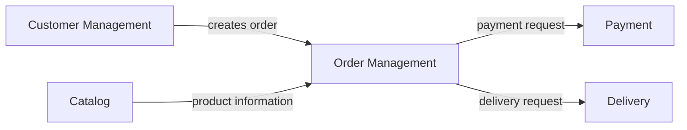
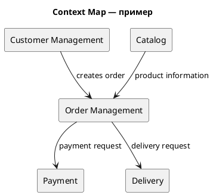

# Лабораторная работа №1

## Декомпозиция системы на микросервисы

`Вариант 2223` `20 млн` `50 000 RPS`

## 1. Предметная область

### Сервис программ лояльности

Платформа бонусных программ для клиентов торговых сетей и сервисных компаний.

## 2. Бизнес-возможности

- клиенты
- бонусные счета
- начисления
- списания
- уровни лояльности
- промокоды
- правила бонусов
- уведомления

## 3. Основные сущности

`Customer` `LoyaltyAccount` `Transaction` `LoyaltyLevel` `PromoCode` `Rule` `Campaign` `Notification`

## 4. Архитектурные ограничения

> ### Независимое масштабирование
>
> Различные части системы должны иметь возможность масштабироваться независимо друг от друга.

<!-- -->

> ### Независимое развертывание
>
> Отдельные части системы должны иметь возможность развертываться независимо.

<!-- -->

> ### Владение данными
>
> Каждая бизнес-область должна иметь явно определённого владельца своих данных.

- История операций должна храниться отдельно от транзакционных данных
- 5 команд разработки

## 5. Задание

Необходимо спроектировать декомпозицию исходного монолитного приложения на микросервисную архитектуру.

1. Определить основные bounded contexts.
2. Определить границы микросервисов.
3. Определить ответственность каждого сервиса.
4. Определить владельца данных каждого сервиса.
5. Определить основные взаимодействия между сервисами.
6. Обосновать выбранную декомпозицию.
7. Привести минимум две альтернативы.
8. Указать потенциальные проблемы архитектуры.

## 6. Что необходимо сдать

<table>
<thead>
<tr>
<th>Артефакт</th>
<th>Формат</th>
</tr>
</thead>
<tbody>
<tr>
<td>Context Map</td>
<td>

Постройте Context Map предметной области в PlantUML.

На диаграмме необходимо показать:

- основные bounded contexts;
- отношения между bounded contexts;
- направление взаимодействия;
- назначение основных взаимодействий.



<details>
<summary>Исходник PlantUML</summary>



</details>

</td>
</tr>
<tr>
<td>Каталог микросервисов</td>
<td>

Пример описания одного сервиса:

```text
Service: Order Service

Responsibility:
Создание и управление заказами пользователей.

Owned Data:
Order
OrderItem

API:
POST /orders
GET /orders/{id}
POST /orders/{id}/cancel

Dependencies:
Catalog Service
Payment Service

Communication:
REST + Kafka

Scalability:
Горизонтальное масштабирование.
```

</td>
</tr>
<tr>
<td>ADR-001. Архитектурное решение</td>
<td>

Зафиксируйте одно из ключевых архитектурных решений, принятых при декомпозиции системы. ADR должен содержать:

- контекст проблем;
- рассмотренные альтернативы — минимум 2;
- выбранное решение;
- обоснование выбора;
- положительные и отрицательные последствия;
- итоговая архитектурная схема в C4.

</td>
</tr>
</tbody>
</table>
