# Декомпозиция системы на микросервисы

## 0. Допущения

- **Клиенты и бонусные счета**
  - у клиента один глобальный ИД
  - но отдельный бонусный счет в каждой программе

- **Владение программами и участие компаний**
  - у программы есть компания-владелец
  - другие компании могут подключаться к программе с ее разрешения
  - одна компания может владеть своей программой и участвовать в чужих

- **Операции и изоляция балансов**
  - компании подключаются к программе, а операции проводят по счетам ее клиентов
  - баланс счёта общий для участников одной программы
  - балансы разных программ независимы, обмена бонусами между ними нет

- **Задержка обновления истории**
  - после подтверждения начисления или списания операция может появиться в истории позже обновления счёта

- **Профиль входящей нагрузки**
  - 50 000 RPS: 85% чтений (42 500 RPS), 15% записей (7 500 RPS)
  - [данные Rakuten Points за 2023 год][rakuten-load]: 50 млрд справочных, 8 млрд транзакционных запросов

[rakuten-load]: https://static.pingcap.co.jp/files/2024/09/26135458/HTAP-Summit-2024-Rakuten.pdf#page=8

## 1. Context Map

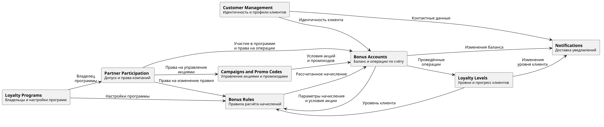

Стрелка направлена от источника информации к её получателю.

<details>
<summary>Исходник PlantUML и генерация PNG/SVG</summary>

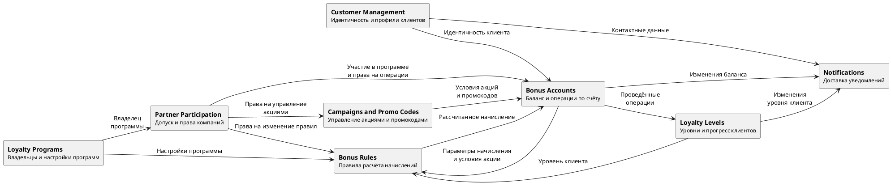

```bash
# Из корня репозитория; нужна команда plantuml.
format=svg # или png
image="docs/img/context-map-$(date +%Y%m%d-%H%M%S).$format"
sed -n '/^@startuml ContextMap$/,/^@enduml$/p' docs/decomposition.md > /tmp/microservices-context-map.puml
plantuml -t"$format" -pipe < /tmp/microservices-context-map.puml > "$image"
```

</details>

## 2. Каталог микросервисов

### 2.1. Customer Management

```text
Service: Customer Management (контекст: Customer Management)

Responsibility:
единая идентичность клиента, профиль и контактные данные.
При регистрации merchantId сверяется с компанией из проверенной учётной записи вызывающего.

Owned Data:
Customer (профиль, контакты, привязки к компаниям и внешним идентификаторам)

API:
- POST /customers — зарегистрировать клиента
  Запрос:
    {
      "name": "Анна",
      "contacts": {
        "email": "anna@example.test",
        "phone": "+12025550142"
      },
      "merchantId": "shop-8",
      "externalCustomerId": "ext-42"
    }
  Ответ:
    {
      "customerId": "cust-42"
    }

- GET /customers/{customerId} — получить профиль и контакты
  Ответ:
    {
      "name": "Анна",
      "contacts": {
        "email": "anna@example.test",
        "phone": "+12025550142"
      }
    }

- PATCH /customers/{customerId} — обновить профиль или контакты
  Запрос:
    {
      "contacts": {
        "email": "anna.new@example.test",
        "phone": "+12025550143"
      }
    }
  Ответ:
    OK

Dependencies:
in:
- Нет
out:
- Bonus Accounts : идентичность клиента для открытия счёта
- Notifications : контакты клиента для доставки уведомлений

Communication:
REST - API профиля клиента и получение контактных данных.

Scalability:
Горизонтальное масштабирование сервиса.
Шардирование профилей по customerId; поиск профиля и контактов по первичному ключу.
Уникальный индекс (merchant_id, external_customer_id) для сопоставления с customerId.
```

### 2.2. Program and Partner Management

```text
Service: Program and Partner Management (контексты: Loyalty Programs, Partner Participation)

Responsibility:
создание программ, регистрация компаний, одобрение участия и управление правами партнёров. Создание
программы включает участие её владельца.

Owned Data:
LoyaltyProgram (компания-владелец)
Merchant (название и юридические реквизиты)
ProgramMembership (статус участия компании и её права в программе)

API:
- POST /merchants — зарегистрировать компанию
  Запрос:
    {
      "name": "Магазин",
      "legalName": "ООО «Пример»",
      "inn": "<ИНН>",
      "ogrn": "<ОГРН>",
      "legalAddress": "<юридический адрес>"
    }
  Ответ:
    {
      "merchantId": "shop-7"
    }

- POST /programs — создать программу
  Запрос:
    {
      "name": "Бонусы за покупки",
      "ownerMerchantId": "shop-7",
      "settings": {
        "currency": "RUB"
      }
    }
  Ответ:
    {
      "programId": "prog-1"
    }

- POST /programs/{programId}/memberships — подать заявку на участие
  Запрос:
    {
      "merchantId": "shop-8"
    }
  Ответ:
    {
      "status": "PENDING"
    }

- PATCH /programs/{programId}/memberships/{merchantId} — изменить статус или права участника
  Запрос:
    {
      "status": "ACTIVE",
      "permissions": [
        "ACCRUE",
        "REDEEM"
      ]
    }
  Ответ:
    OK

- POST /permissions/check — проверить право на действие в программе
  Запрос:
    {
      "programId": "prog-1",
      "merchantId": "shop-7",
      "action": "ACCRUE"
    }
  Ответ:
    {
      "allowed": true
    }

Dependencies:
in:
- Нет
out:
- Bonus Accounts : участие компании в программе и права на операции
- Loyalty Rules and Levels : настройки программы и права на изменение правил
- Campaigns and Promo Codes : участие компании и права управления акциями

Communication:
REST - API программ и компаний, управление участием и проверка прав.
Kafka - передача настроек созданных программ в Loyalty Rules and Levels.

Scalability:
Горизонтальное масштабирование сервиса.
Уникальный индекс (program_id, merchant_id) для проверки участия и прав компании в программе.
```

### 2.3. Bonus Accounts

```text
Service: Bonus Accounts (контекст: Bonus Accounts)

Responsibility:
открытие счёта клиента в программе, баланс, проведение начислений и списаний; защита
от повторных операций и отрицательного остатка.

Owned Data:
LoyaltyAccount (баланс клиента в конкретной программе)
Transaction (начисление или списание, компания и результат операции)

API:
- POST /programs/{programId}/accounts — открыть бонусный счёт в указанной программе
  Запрос:
    {
      "customerId": "cust-42"
    }
  Ответ:
    {
      "accountId": "acc-42"
    }

- GET /accounts/{accountId} — получить счёт и текущий баланс
  Ответ:
    {
      "programId": "prog-1",
      "customerId": "cust-42",
      "balance": 1200
    }

- POST /accounts/{accountId}/accruals — начислить бонусы за покупку
  Запрос:
    Idempotency-Key: order-816
    {
      "purchaseAmount": 3000,
      "currency": "RUB",
      "promoCode": "WELCOME" // при наличии
    }
  Ответ:
    {
      "operationId": "op-900",
      "points": 300,
      "balance": 1500
    }

- POST /accounts/{accountId}/redemptions — списать бонусы
  Запрос:
    Idempotency-Key: order-817
    {
      "points": 300
    }
  Ответ:
    {
      "operationId": "op-901",
      "balance": 1200
    }

Dependencies:
in:
- Customer Management : идентичность клиента
- Program and Partner Management : участие компании и права на операции
- Loyalty Rules and Levels : результат расчёта начисления и уровень клиента
- Campaigns and Promo Codes : условия применения акций и промокодов
out:
- Loyalty Rules and Levels : операции для пересчёта уровня и условия акции для расчёта бонусов
- Operation History : проведённые операции по счёту
- Notifications : изменения баланса клиента

Communication:
REST - API счетов, начислений и списаний; проверка прав и получение условий начисления.
Kafka - передача проведённых операций для истории, пересчёта уровней и уведомлений.

Scalability:
Горизонтальное масштабирование сервиса.
Счёт и его операции хранятся на одном шарде. Размещение счёта определяется парой (program_id, customer_id),
по accountId можно определить его шард.
Уникальный индекс (program_id, customer_id) для открытия одного счёта клиента в программе.
Уникальный индекс (account_id, merchant_id, idempotency_key) для защиты от повторного проведения операции.
Индекс outbox (created_at, id) для выборки сообщений к публикации.
```

### 2.4. Loyalty Rules and Levels

```text
Service: Loyalty Rules and Levels (контексты: Bonus Rules, Loyalty Levels)

Responsibility:
расчёт начисления по правилам программы, уровню клиента и условиям акции; определение и пересчёт
уровней.

Owned Data:
Rule
LoyaltyLevel
CustomerLevel (уровень и прогресс клиента в конкретной программе)

API:
- POST /programs/{programId}/calculations — рассчитать начисление
  Запрос:
    {
      "customerId": "cust-42",
      "purchaseAmount": 3000,
      "currency": "RUB",
      "campaignTerms": { // при наличии
        "bonusMultiplier": 2
      }
    }
  Ответ:
    {
      "points": 300
    }

- PUT /programs/{programId}/rules/{ruleId} — сохранить правило начисления
  Запрос:
    {
      "conditions": {
        "minPurchaseAmount": 1000
      },
      "reward": {
        "percent": 5
      }
    }
  Ответ:
    OK

- GET /programs/{programId}/customers/{customerId}/level — получить уровень и прогресс
  Ответ:
    {
      "level": "SILVER",
      "progress": {
        "earnedPoints": 1500
      }
    }

Dependencies:
in:
- Program and Partner Management : настройки программы и права на изменение правил
- Bonus Accounts : проведённые операции и проверенные условия акции
out:
- Bonus Accounts : результат расчёта начисления и уровень клиента
- Notifications : изменения уровня клиента

Communication:
REST - управление правилами, расчёт начисления и получение уровня клиента.
Kafka - получение настроек программ и операций по счетам, передача изменений уровня.

Scalability:
Горизонтальное масштабирование сервиса.
Отдельная инсталляция Redis: набор действующих правил по programId.
При промахе читаем из БД и сохраняем с TTL; после изменения правил или настроек программы сбрасываем запись.
Индекс (program_id, status) для загрузки действующих правил программы.
Уникальный индекс (program_id, customer_id) для чтения и обновления уровня клиента.
```

### 2.5. Campaigns and Promo Codes

```text
Service: Campaigns and Promo Codes (контекст: Campaigns and Promo Codes)

Responsibility:
управление акциями и промокодами. При проверке кода учитываются срок действия, компания и условия покупки.

Owned Data:
Campaign (программа, условия и компании-участники)
PromoCode (программа, условия, срок действия и компании-участники; код уникален в программе)

API:
- POST /programs/{programId}/campaigns — создать акцию
  Запрос:
    {
      "name": "Двойные бонусы",
      "terms": {
        "bonusMultiplier": 2
      },
      "merchantIds": [
        "shop-8"
      ]
    }
  Ответ:
    {
      "campaignId": "campaign-1"
    }

- POST /programs/{programId}/promocodes — создать промокод
  Запрос:
    {
      "code": "WELCOME",
      "expiresAt": "2027-12-31T23:59:59Z",
      "terms": {
        "bonusMultiplier": 2
      },
      "merchantIds": [
        "shop-8"
      ]
    }
  Ответ:
    {
      "promoCodeId": "promo-1"
    }

- POST /programs/{programId}/promocodes/validate — проверить применимость промокода к покупке
  Запрос:
    {
      "code": "WELCOME",
      "merchantId": "shop-8",
      "purchaseAmount": 3000,
      "currency": "RUB"
    }
  Ответ:
    {
      "applicable": true,
      "campaignTerms": {
        "bonusMultiplier": 2
      }
    }

Dependencies:
in:
- Program and Partner Management : участие компании и права управления акциями
out:
- Bonus Accounts : условия применения акций и промокодов

Communication:
REST - API акций и промокодов, проверка условий их применения.

Scalability:
Горизонтальное масштабирование сервиса.
Отдельная инсталляция Redis: определения акций по (programId, campaignId), промокодов — по (programId, code).
При промахе читаем из БД и сохраняем с TTL; после изменений сбрасываем затронутые записи.
Уникальный индекс (program_id, code) для поиска промокода и уникальности кода внутри программы.
```

### 2.6. Notifications

```text
Service: Notifications (контекст: Notifications)

Responsibility:
формирование и доставка уведомлений об изменениях баланса и уровня. Сервис отдельно обрабатывает события,
повторяет неудачные отправки и изолирует бонусные операции от сбоев провайдеров доставки.

Owned Data:
Notification (получатель, канал, статус и время следующей попытки доставки)

API:
- GET /notifications/{notificationId} — получить статус доставки
  Ответ:
    {
      "channel": "EMAIL",
      "status": "DELIVERED"
    }

Dependencies:
in:
- Bonus Accounts : изменения баланса клиента
- Loyalty Rules and Levels : изменения уровня клиента
- Customer Management : контакты клиента
out:
- Messaging Providers : уведомления для внешней доставки клиентам

Communication:
REST - API статуса уведомления и получение контактов клиента.
Kafka - получение изменений баланса и уровня для подготовки уведомлений.
HTTPS - передача уведомлений внешним провайдерам доставки.

Scalability:
Горизонтальное масштабирование обработчиков уведомлений.
Индекс (status, next_attempt_at) для выборки уведомлений, готовых к повторной отправке.
```

### 2.7. Operation History

```text
Service: Operation History (проекция контекста Bonus Accounts, без собственного контекста)

Responsibility:
построение и чтение долговременной истории операций в отдельном от транзакционных данных хранилище.
Чтение истории и обработку событий можно масштабировать отдельно от проведения бонусных операций.
История доступна только клиенту по его счёту. При чтении сервис сверяет ID клиента с владельцем счёта в проекции.

Owned Data:
OperationHistory (счёт, программа, клиент, компания и проведённые операции)

API:
- GET /accounts/{accountId}/history — получить историю своего счёта от новых операций к старым
  Запрос:
    ?cursor=cursor-1  // для следующей страницы
  Ответ:
    {
      "operations": [
        {
          "operationId": "op-901",
          "type": "REDEMPTION",
          "points": 300,
          "occurredAt": "2026-11-13T10:00:00Z",
          "merchantId": "shop-8"
        }
      ],
      "nextCursor": "cursor-2"
    }

Dependencies:
in:
- Bonus Accounts : проведённые операции по счёту
out:
- Нет

Communication:
REST - чтение истории счёта его владельцем.
Kafka - получение проведённых операций для построения истории.

Scalability:
Горизонтальное масштабирование сервиса.
Шардирование БД по бонусным счетам.
Индекс B-tree (account_id, occurred_at DESC, operation_id DESC) для курсорной пагинации по счёту.
Уникальный индекс (account_id, operation_id) для защиты от дублей при повторной доставке событий.
```

### 2.8. API Gateway

```text
Service: API Gateway (без доменного контекста)

Responsibility:
единая точка входа для прикладного API и входа в систему.
Маршруты входа и выдачи токенов проксирует в Keycloak без требования токена доступа.
На прикладных маршрутах проверяет токен доступа и направляет вызов нужному сервису.

Owned Data:
Нет

API:
- GET /accounts/{accountId} — пример внешнего маршрута к Bonus Accounts
  Запрос:
    Authorization: Bearer <access_token>
  Ответ:
    {
      "programId": "prog-1",
      "customerId": "cust-42",
      "balance": 1200
    }

Dependencies:
in:
- Keycloak : публичные ключи для проверки токенов (JWKS)
out:
- Keycloak : запросы входа и выдачи токенов
- Прикладные сервисы : запросы с проверенной идентичностью вызывающего

Communication:
HTTPS / REST - маршрутизация прикладных запросов.
HTTPS - проксирование маршрутов входа и выдачи токенов, получение JWKS.

Scalability:
Горизонтальное масштабирование реплик.
Публичные ключи хранятся локально в памяти реплик с периодическим обновлением.
Ориентир — 50 000 RPS.
```

### 2.T. Команды

| Команда | Сервисы | Зона ответственности |
| --- | --- | --- |
| 1 | `Bonus Accounts`, `Operation History` | Проведение операций и их отображение в истории |
| 2 | `Program and Partner Management`, `Campaigns and Promo Codes` | Программы и акции |
| 3 | `Loyalty Rules and Levels` | Расчёт начислений и прогресс клиента |
| 4 | `Customer Management`, `Notifications` | Профили, контакты и доставка уведомлений |
| 5 | `API Gateway`, Keycloak (SSO), общая Kafka | Доступность и мониторинг |

## 3. ADR-001. Единое владение бонусным балансом

### 3.1. Контекст

Ожидаемая нагрузка: 20 млн клиентов и 50 000 RPS. По допущению это 42 500 запросов на чтение
и 7 500 запросов на запись в секунду.

Части системы должны масштабироваться независимо. История операций хранится отдельно от транзакционных данных
и по допущению может обновляться позже баланса.

Счёт клиента в программе используется разными компаниями-участниками. Нужно определить владельца баланса
и границы его ответственности при начислении и списании бонусов.

### 3.2. Выбранное решение

Единственным владельцем счетов и их балансов является `Bonus Accounts`. Он открывает счета клиентов в программах,
проводит начисления и списания, проверяет остаток и защищает от повторного проведения операции.

Проверка остатка, изменение баланса и фиксация результата операции выполняются одной транзакцией в его БД.
Остальные сервисы не изменяют баланс напрямую.

Расчёт бонусов, применение промокодов, пересчёт уровней, долговременная история и доставка уведомлений
остаются за пределами ответственности `Bonus Accounts`. Он проводит только операции с балансом.

Остальные сервисы получают сведения о подтверждённых изменениях баланса через асинхронные события или выгрузки операций
и самостоятельно обновляют свои данные. Ответ о проведении операции не ожидает обработки её результатов потребителями.

Для публикации событий используется паттерн Transactional Outbox: операция и сообщение фиксируются одной транзакцией,
а отправка в брокер выполняется после её завершения.

### 3.3. Альтернативы

1. **Объединить баланс, расчёт бонусов, промокоды и уровни в `Bonus Accounts`**
   - **Преимущества:** меньше межсервисных взаимодействий при начислении, связанные изменения выполняются локально.
   - **Недостатки:** изменение правил и маркетинговых условий связано с выпуском сервиса счетов.
     Расчёт бонусов и проведение операций используют общие ресурсы и масштабируются вместе.
2. **Разделить начисления и списания между сервисами с доступом к общей БД счетов**
   - **Преимущества:** независимое развёртывание обработчиков, проверка остатка и изменение баланса в транзакции общей БД.
   - **Недостатки:** общая схема и правила проведения операций требуют согласования между сервисами.
     Ответственность за корректность баланса распределена, а БД остаётся общим ограничением масштабирования.
3. **Разделить начисления и списания между сервисами с собственными БД**
   - **Преимущества:** обработчики и их хранилища можно развёртывать и масштабировать независимо.
   - **Недостатки:** для проверки остатка нужна координация изменений одного счёта между сервисами.
     Согласованность баланса и защита от повторов усложняются из-за распределения данных.
4. **Выделить отдельный сервис учёта для каждой программы**
   - **Преимущества:** программы изолированы по данным и ресурсам, их учёт можно развивать независимо.
   - **Недостатки:** нужно поддерживать реализацию учёта и инфраструктуру для каждой программы.
     Участников необходимо направлять в сервис нужной программы, сохраняя единый счёт клиента внутри неё.

### 3.4. Обоснование выбора

- Единый владелец баланса обеспечивает одну точку проведения операций разных компаний по общему счёту клиента
  и позволяет проверять остаток и изменять его в одной транзакции.
- Для системы с 20 млн клиентов счёт остаётся самостоятельной единицей учёта. Владение балансом не требует
  включать в сервис счетов все процессы, использующие сведения о клиенте и его операциях.
- При целевых 50 000 RPS расчёт правил, чтение истории и доставка уведомлений могут масштабироваться отдельно
  от изменения баланса. Ресурсы каждого сервиса подбираются под фактическую долю запросов.
- События и выгрузки позволяют потребителям самостоятельно обрабатывать изменения без участия `Bonus Accounts`
  в их бизнес-процессах. Отдельное хранение истории выполняет прямое требование задания.
- Граница владения данными остаётся явной: только `Bonus Accounts` принимает решения о проведении операции
  и хранит актуальный баланс счёта.

### 3.5. Последствия

- **Положительные:** явный владелец баланса, локальная согласованность начислений и списаний, независимое
  развитие остальных сервисов. Недоступность потребителя событий не требует ожидать его при проведении операции.
- **Отрицательные:** недоступность `Bonus Accounts` блокирует изменение баланса. Нужны надёжная публикация,
  обработка повторов и контроль отставания потребителей. Сбой публикации увеличивает outbox,
  а выгрузки создают дополнительную нагрузку на БД счетов.
- **Согласованность:** данные об истории, уровнях и уведомлениях могут отставать от актуального баланса.
  Допустимую задержку необходимо согласовать с бизнес-требованиями.
- **Проверка производительности:** единое владение не определяет число реплик или производительность БД
  и не гарантирует выдержки заданной нагрузки. Нужны профиль запросов и нагрузочные испытания.

### 3.6. Итоговые C4-диаграммы

#### 3.6.1. Контекстная диаграмма

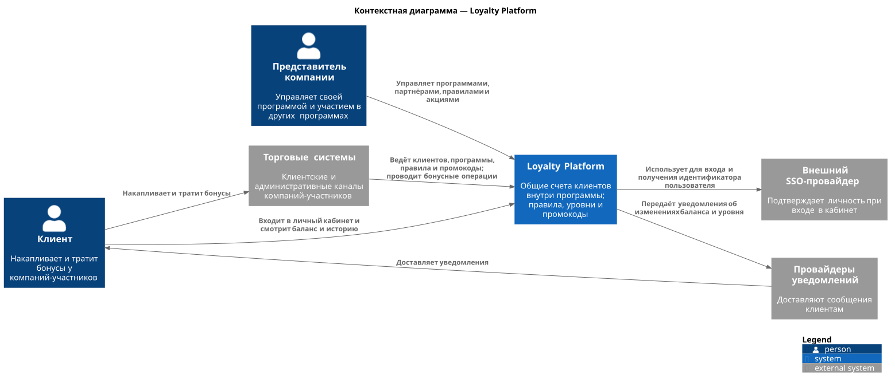

<details>
<summary>Исходник PlantUML и генерация PNG/SVG</summary>

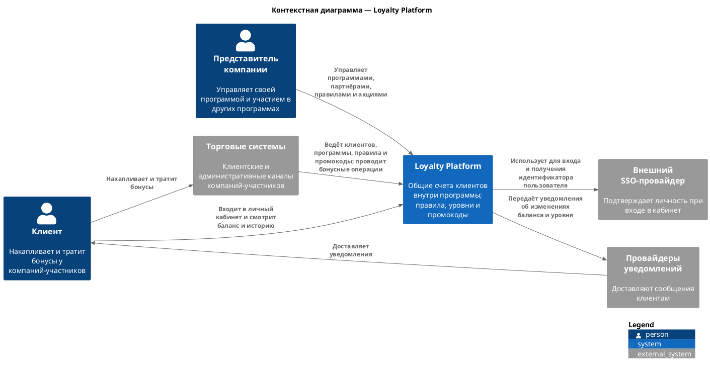

```bash
# Из корня репозитория; нужна команда plantuml со стандартной библиотекой C4.
format=svg # или png
image="docs/img/c4-context-$(date +%Y%m%d-%H%M%S).$format"
sed -n '/^@startuml C4Context$/,/^@enduml$/p' docs/decomposition.md > /tmp/microservices-c4-context.puml
plantuml -t"$format" -pipe < /tmp/microservices-c4-context.puml > "$image"
```

</details>

#### 3.6.2. Контейнерная диаграмма

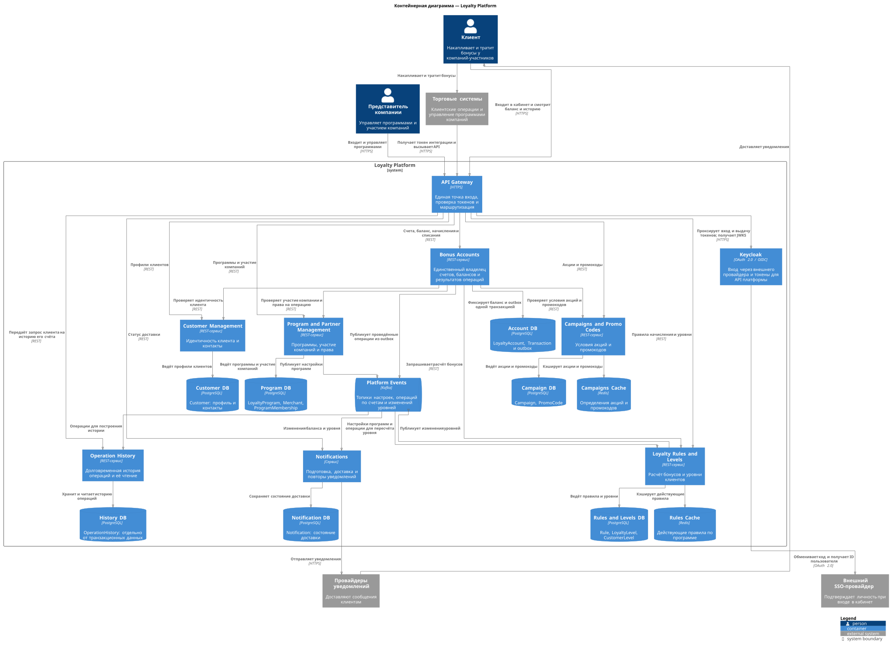

<details>
<summary>Исходник PlantUML и генерация PNG/SVG</summary>

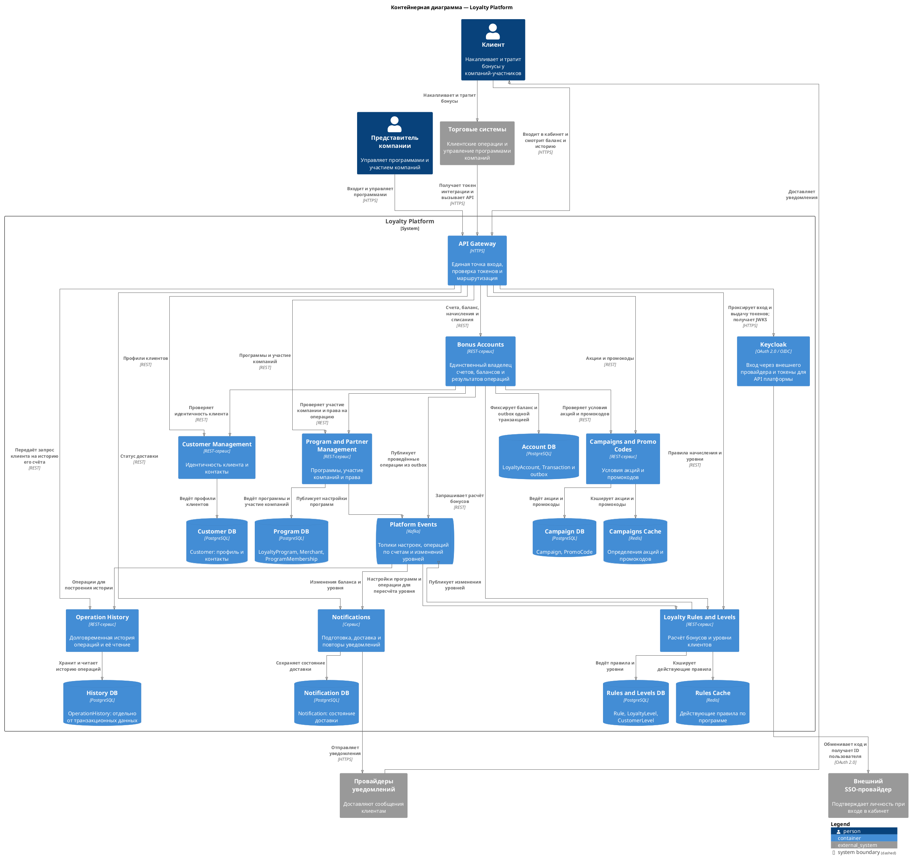

```bash
# Из корня репозитория; нужна команда plantuml со стандартной библиотекой C4.
format=svg # или png
image="docs/img/c4-container-$(date +%Y%m%d-%H%M%S).$format"
sed -n '/^@startuml C4Container$/,/^@enduml$/p' docs/decomposition.md > /tmp/microservices-c4-container.puml
plantuml -t"$format" -pipe < /tmp/microservices-c4-container.puml > "$image"
```

</details>

#### 3.6.3. Компонентные диаграммы

##### [Customer Management](#21-customer-management)

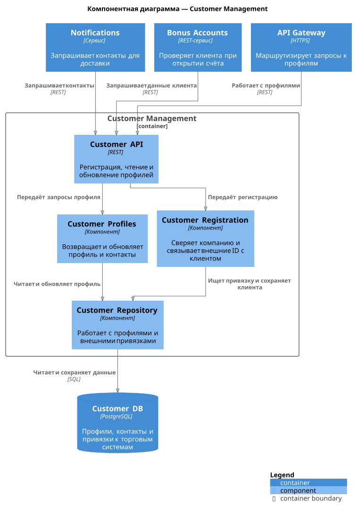

<details>
<summary>Исходник PlantUML и генерация PNG/SVG</summary>

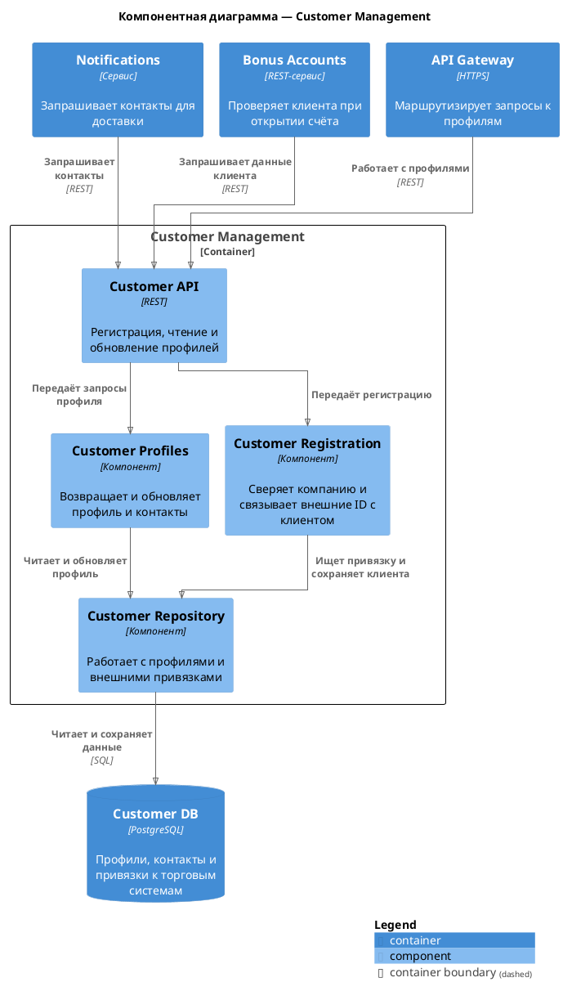

```bash
# Из корня репозитория; нужна команда plantuml со стандартной библиотекой C4.
format=svg # или png
image="docs/img/c4-component-customer-management-$(date +%Y%m%d-%H%M%S).$format"
sed -n '/^@startuml C4ComponentCustomers$/,/^@enduml$/p' docs/decomposition.md > /tmp/microservices-c4-component.puml
plantuml -t"$format" -pipe < /tmp/microservices-c4-component.puml > "$image"
```

</details>

##### [Program and Partner Management](#22-program-and-partner-management)

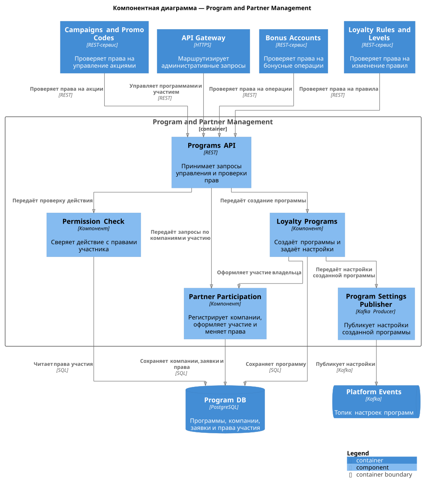

<details>
<summary>Исходник PlantUML и генерация PNG/SVG</summary>

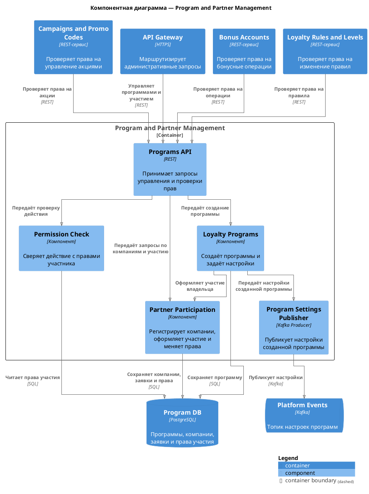

```bash
# Из корня репозитория; нужна команда plantuml со стандартной библиотекой C4.
format=svg # или png
image="docs/img/c4-component-program-and-partner-management-$(date +%Y%m%d-%H%M%S).$format"
sed -n '/^@startuml C4ComponentPrograms$/,/^@enduml$/p' docs/decomposition.md > /tmp/microservices-c4-component.puml
plantuml -t"$format" -pipe < /tmp/microservices-c4-component.puml > "$image"
```

</details>

##### [Bonus Accounts](#23-bonus-accounts)

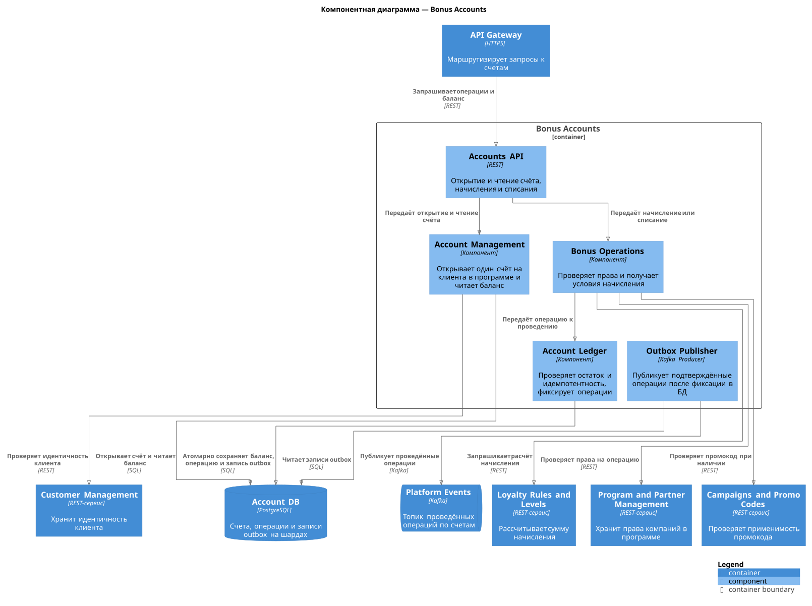

<details>
<summary>Исходник PlantUML и генерация PNG/SVG</summary>

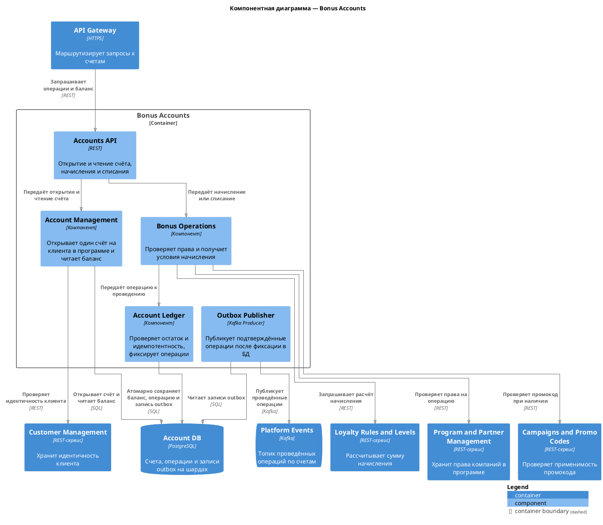

```bash
# Из корня репозитория; нужна команда plantuml со стандартной библиотекой C4.
format=svg # или png
image="docs/img/c4-component-bonus-accounts-$(date +%Y%m%d-%H%M%S).$format"
sed -n '/^@startuml C4ComponentAccounts$/,/^@enduml$/p' docs/decomposition.md > /tmp/microservices-c4-component.puml
plantuml -t"$format" -pipe < /tmp/microservices-c4-component.puml > "$image"
```

</details>

##### [Loyalty Rules and Levels](#24-loyalty-rules-and-levels)

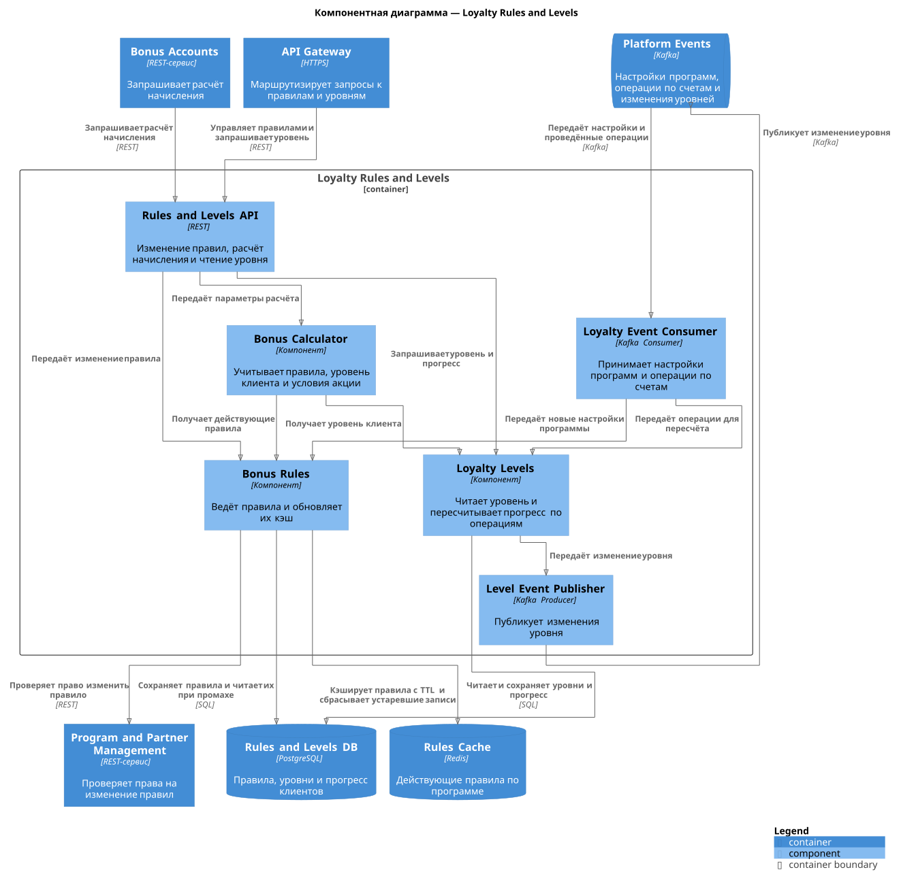

<details>
<summary>Исходник PlantUML и генерация PNG/SVG</summary>

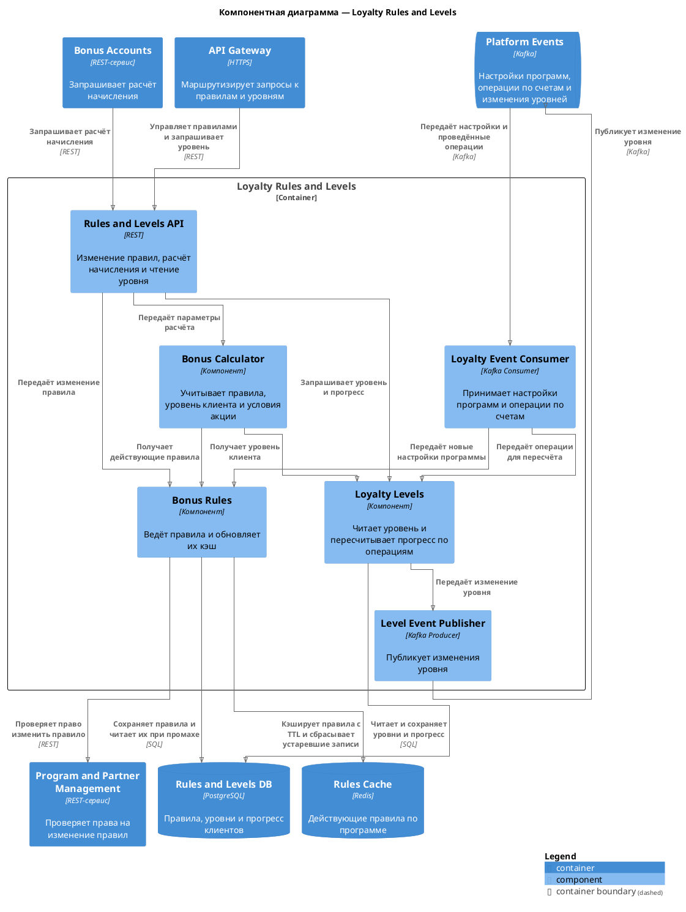

```bash
# Из корня репозитория; нужна команда plantuml со стандартной библиотекой C4.
format=svg # или png
image="docs/img/c4-component-loyalty-rules-and-levels-$(date +%Y%m%d-%H%M%S).$format"
sed -n '/^@startuml C4ComponentRules$/,/^@enduml$/p' docs/decomposition.md > /tmp/microservices-c4-component.puml
plantuml -t"$format" -pipe < /tmp/microservices-c4-component.puml > "$image"
```

</details>

##### [Campaigns and Promo Codes](#25-campaigns-and-promo-codes)

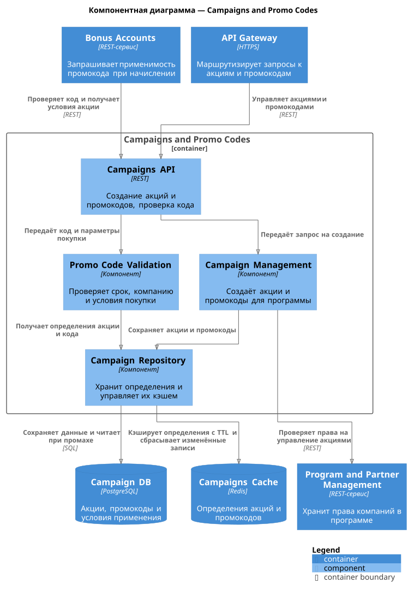

<details>
<summary>Исходник PlantUML и генерация PNG/SVG</summary>

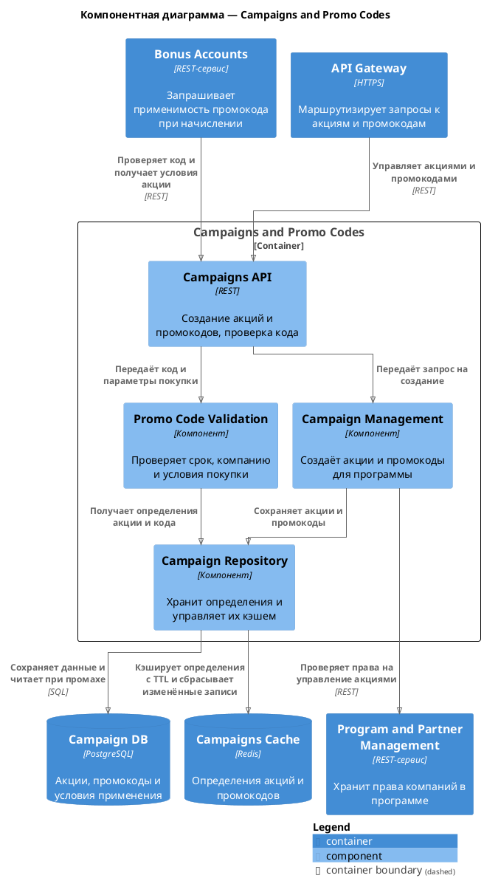

```bash
# Из корня репозитория; нужна команда plantuml со стандартной библиотекой C4.
format=svg # или png
image="docs/img/c4-component-campaigns-and-promo-codes-$(date +%Y%m%d-%H%M%S).$format"
sed -n '/^@startuml C4ComponentCampaigns$/,/^@enduml$/p' docs/decomposition.md > /tmp/microservices-c4-component.puml
plantuml -t"$format" -pipe < /tmp/microservices-c4-component.puml > "$image"
```

</details>

##### [Notifications](#26-notifications)

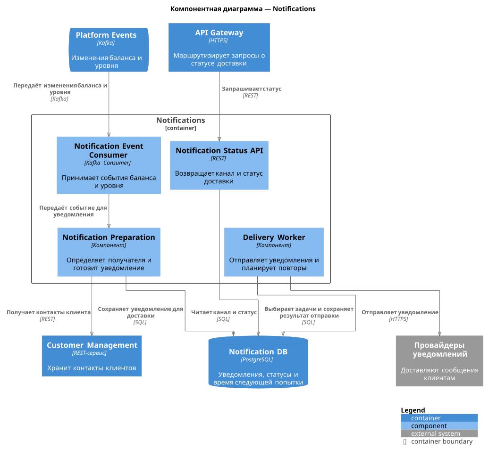

<details>
<summary>Исходник PlantUML и генерация PNG/SVG</summary>

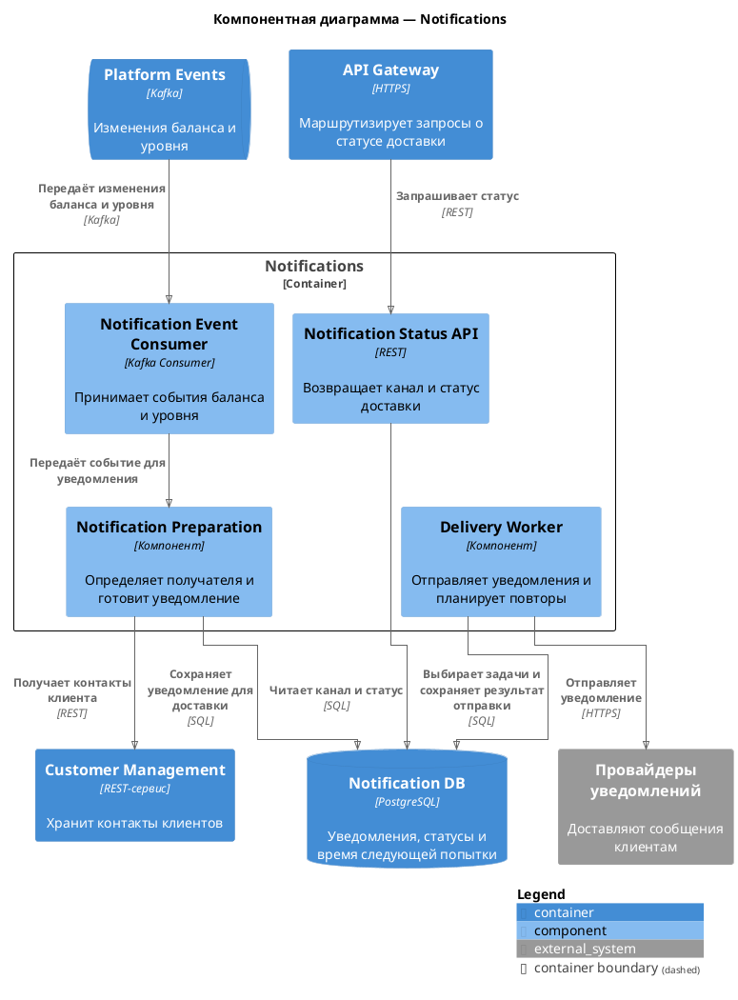

```bash
# Из корня репозитория; нужна команда plantuml со стандартной библиотекой C4.
format=svg # или png
image="docs/img/c4-component-notifications-$(date +%Y%m%d-%H%M%S).$format"
sed -n '/^@startuml C4ComponentNotifications$/,/^@enduml$/p' docs/decomposition.md > /tmp/microservices-c4-component.puml
plantuml -t"$format" -pipe < /tmp/microservices-c4-component.puml > "$image"
```

</details>

##### [Operation History](#27-operation-history)

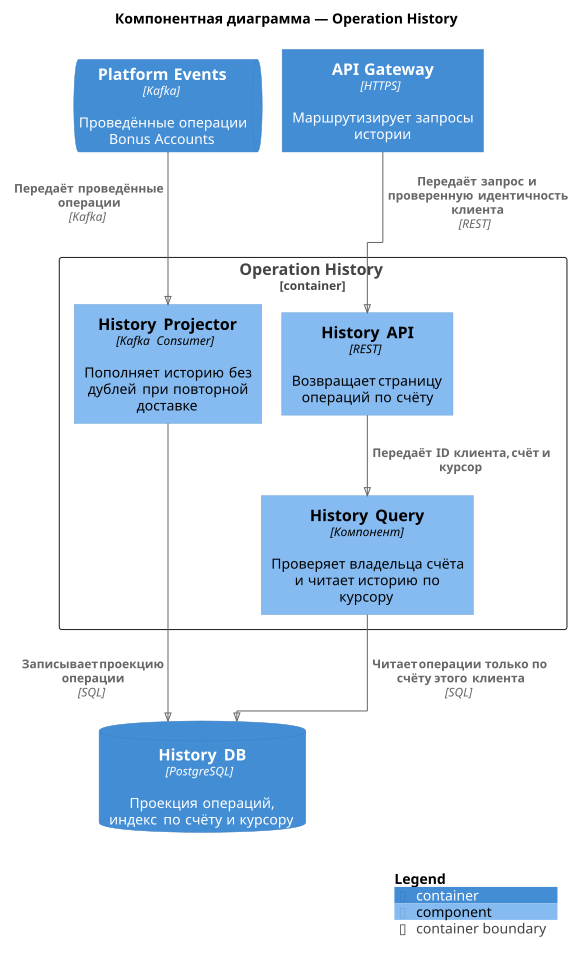

<details>
<summary>Исходник PlantUML и генерация PNG/SVG</summary>

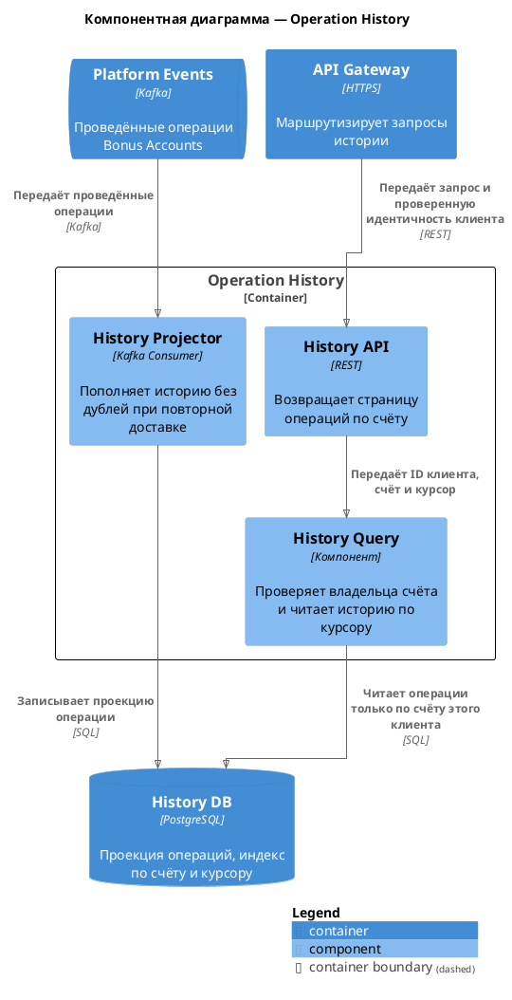

```bash
# Из корня репозитория; нужна команда plantuml со стандартной библиотекой C4.
format=svg # или png
image="docs/img/c4-component-operation-history-$(date +%Y%m%d-%H%M%S).$format"
sed -n '/^@startuml C4ComponentHistory$/,/^@enduml$/p' docs/decomposition.md > /tmp/microservices-c4-component.puml
plantuml -t"$format" -pipe < /tmp/microservices-c4-component.puml > "$image"
```

</details>

##### [API Gateway](#28-api-gateway)

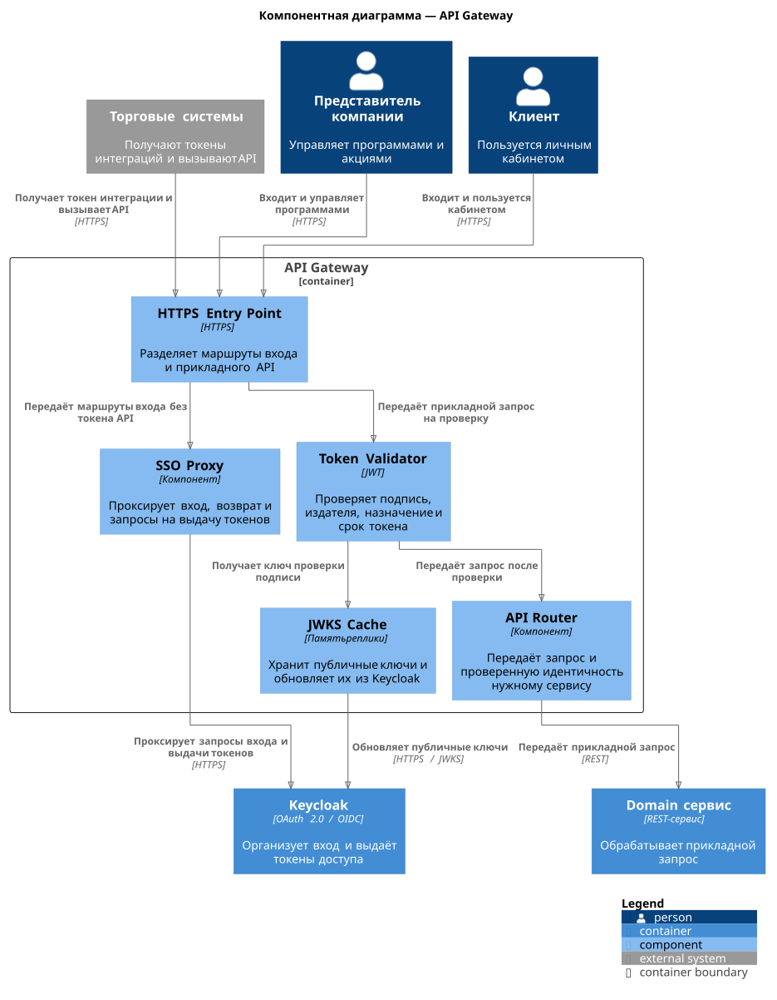

<details>
<summary>Исходник PlantUML и генерация PNG/SVG</summary>

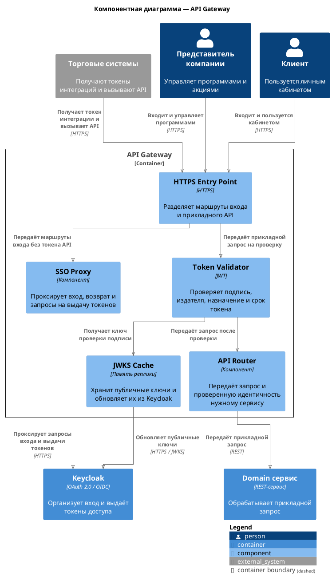

```bash
# Из корня репозитория; нужна команда plantuml со стандартной библиотекой C4.
format=svg # или png
image="docs/img/c4-component-api-gateway-$(date +%Y%m%d-%H%M%S).$format"
sed -n '/^@startuml C4ComponentGateway$/,/^@enduml$/p' docs/decomposition.md > /tmp/microservices-c4-component.puml
plantuml -t"$format" -pipe < /tmp/microservices-c4-component.puml > "$image"
```

</details>
