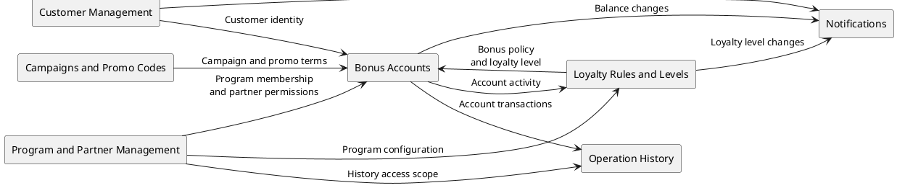

# Декомпозиция системы на микросервисы

## 0. Допущения

- **Клиенты и бонусные счета**
  - у клиента один глобальный ИД
  - но отдельный бонусный счет в каждой программе

- **Владение программами и участие компаний**
  - у программы есть компания-владелец
  - другие компании могут подключаться к программе с ее разрешения
  - одна компания может владеть своей программой и участвовать в чужих

- **Операции и изоляция балансов**
  - компании подключаются к программе, а операции проводят по счетам ее клиентов
  - баланс счёта общий для участников одной программы
  - балансы разных программ независимы, обмена бонусами между ними нет

## 1. Context Map

Внутренние контексты: Customer Management, Program and Partner Management, Bonus Accounts, Loyalty Rules and Levels, Campaigns and Promo Codes, Notifications. Operation History хранит историю операций.

Каждый блок обозначает область ответственности внутри системы. Все связи показаны одинаково: стрелка направлена от источника информации к её получателю, подпись описывает передаваемые данные.


<details>
<summary>Исходник PlantUML и генерация PNG/SVG</summary>



```bash
# Из корня репозитория; нужна команда plantuml.
format=svg # или png
image="docs/img/context-map-$(date +%Y%m%d-%H%M%S).$format"
sed -n '/^@startuml/,/^@enduml/p' docs/decomposition.md > /tmp/microservices-context-map.puml
plantuml -t"$format" -pipe < /tmp/microservices-context-map.puml > "$image"
```

</details>
