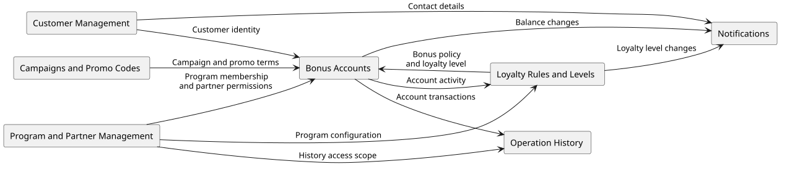
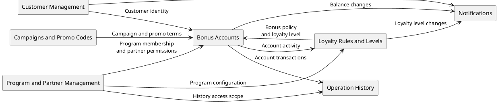

# Декомпозиция системы на микросервисы

## 0. Допущения

- **Клиенты и бонусные счета**
  - у клиента один глобальный ИД
  - но отдельный бонусный счет в каждой программе

- **Владение программами и участие компаний**
  - у программы есть компания-владелец
  - другие компании могут подключаться к программе с ее разрешения
  - одна компания может владеть своей программой и участвовать в чужих

- **Операции и изоляция балансов**
  - компании подключаются к программе, а операции проводят по счетам ее клиентов
  - баланс счёта общий для участников одной программы
  - балансы разных программ независимы, обмена бонусами между ними нет

## 1. Context Map

Внутренние контексты: Customer Management, Program and Partner Management, Bonus Accounts,
Loyalty Rules and Levels, Campaigns and Promo Codes, Notifications. Operation History хранит историю операций.

Каждый блок обозначает область ответственности внутри системы. Все связи показаны одинаково:
стрелка направлена от источника информации к её получателю, подпись описывает передаваемые данные.



<details>
<summary>Исходник PlantUML и генерация PNG/SVG</summary>



```bash
# Из корня репозитория; нужна команда plantuml.
format=svg # или png
image="docs/img/context-map-$(date +%Y%m%d-%H%M%S).$format"
sed -n '/^@startuml/,/^@enduml/p' docs/decomposition.md > /tmp/microservices-context-map.puml
plantuml -t"$format" -pipe < /tmp/microservices-context-map.puml > "$image"
```

</details>

## 2. Каталог микросервисов

### 2.1. Customer Management

```text
Service: Customer Management

Responsibility:
единая идентичность клиента, профиль и контактные данные.

Owned Data:
Customer (профиль, контакты, внешние идентификаторы в торговых системах)

API:
POST /customers
GET /customers/{customerId}
PATCH /customers/{customerId}

Dependencies:
in:
- Нет
out:
- Bonus Accounts : идентичность клиента для открытия счёта
- Notifications : контакты клиента для доставки уведомлений

Communication:
REST - API профиля клиента и получение контактных данных.

Scalability:
Горизонтальное масштабирование сервиса.
Шардирование БД по клиентам.
```

### 2.2. Program and Partner Management

```text
Service: Program and Partner Management

Responsibility:
создание программ, регистрация компаний, одобрение участия и управление правами партнёров. Создание
программы включает участие её владельца.

Owned Data:
LoyaltyProgram (компания-владелец)
Merchant
ProgramMembership (статус участия компании и её права в программе)

API:
POST /merchants
POST /programs
POST /programs/{programId}/memberships
PATCH /programs/{programId}/memberships/{merchantId}
POST /permissions/check

Dependencies:
in:
- Нет
out:
- Bonus Accounts : участие компании в программе и права на операции
- Loyalty Rules and Levels : настройки программы и права на изменение правил
- Campaigns and Promo Codes : участие компании и права управления акциями
- Operation History : область доступа к истории операций

Communication:
REST - API программ и компаний, управление участием и проверка прав.
Kafka - передача настроек созданных программ в Loyalty Rules and Levels.

Scalability:
Горизонтальное масштабирование сервиса.
```

### 2.3. Bonus Accounts

```text
Service: Bonus Accounts

Responsibility:
открытие счёта клиента в программе, баланс, проведение начислений и списаний; защита
от повторных операций и отрицательного остатка.

Owned Data:
LoyaltyAccount (баланс клиента в конкретной программе)
Transaction (начисление или списание, компания и результат операции)

API:
POST /programs/{programId}/accounts
GET /accounts/{accountId}
POST /accounts/{accountId}/accruals
POST /accounts/{accountId}/redemptions

Dependencies:
in:
- Customer Management : идентичность клиента
- Program and Partner Management : участие компании и права на операции
- Loyalty Rules and Levels : результат расчёта начисления и уровень клиента
- Campaigns and Promo Codes : условия применения акций и промокодов
out:
- Loyalty Rules and Levels : операции для пересчёта уровня и условия акции для расчёта бонусов
- Operation History : проведённые операции по счёту
- Notifications : изменения баланса клиента

Communication:
REST - API счетов, начислений и списаний; проверка прав и получение условий начисления.
Kafka - передача проведённых операций для истории, пересчёта уровней и уведомлений.

Scalability:
Горизонтальное масштабирование сервиса.
Шардирование БД по бонусным счетам.
```

### 2.4. Loyalty Rules and Levels

```text
Service: Loyalty Rules and Levels

Responsibility:
расчёт начисления по правилам программы, уровню клиента и условиям акции; определение и пересчёт
уровней.

Owned Data:
Rule
LoyaltyLevel
CustomerLevel (уровень и прогресс клиента в конкретной программе)

API:
POST /programs/{programId}/calculations
PUT /programs/{programId}/rules/{ruleId}
GET /programs/{programId}/customers/{customerId}/level

Dependencies:
in:
- Program and Partner Management : настройки программы и права на изменение правил
- Bonus Accounts : проведённые операции и проверенные условия акции
out:
- Bonus Accounts : результат расчёта начисления и уровень клиента
- Notifications : изменения уровня клиента

Communication:
REST - управление правилами, расчёт начисления и получение уровня клиента.
Kafka - получение настроек программ и операций по счетам, передача изменений уровня.

Scalability:
Горизонтальное масштабирование сервиса.
Кеширование правил программы.
```

### 2.5. Campaigns and Promo Codes

```text
Service: Campaigns and Promo Codes

Responsibility:
управление акциями и промокодами, проверка сроков и условий их применения в программе и компании.

Owned Data:
Campaign (программа, условия и компании-участники)
PromoCode (программа, условия, срок действия и компании-участники; код уникален в программе)

API:
POST /programs/{programId}/campaigns
POST /programs/{programId}/promocodes
POST /programs/{programId}/promocodes/validate

Dependencies:
in:
- Program and Partner Management : участие компании и права управления акциями
out:
- Bonus Accounts : условия применения акций и промокодов

Communication:
REST - API акций и промокодов, проверка условий их применения.

Scalability:
Горизонтальное масштабирование сервиса.
Кеширование акций и промокодов.
```

### 2.6. Notifications

```text
Service: Notifications

Responsibility:
формирование и доставка уведомлений об изменениях баланса и уровня, повторные попытки доставки.

Owned Data:
Notification (получатель, канал и статус доставки)

API:
GET /notifications/{notificationId}

Dependencies:
in:
- Bonus Accounts : изменения баланса клиента
- Loyalty Rules and Levels : изменения уровня клиента
- Customer Management : контакты клиента
out:
- Messaging Providers : уведомления для внешней доставки клиентам

Communication:
REST - API статуса уведомления и получение контактов клиента.
Kafka - получение изменений баланса и уровня для подготовки уведомлений.
HTTPS - передача уведомлений внешним провайдерам доставки.

Scalability:
Горизонтальное масштабирование обработчиков уведомлений.
```

### 2.7. Operation History

```text
Service: Operation History

Responsibility:
построение и чтение долговременной истории операций в отдельном от транзакционных данных хранилище.

Owned Data:
OperationHistory (счёт, программа, клиент, компания и проведённые операции)

API:
GET /accounts/{accountId}/history
Курсорная пагинация.

Dependencies:
in:
- Bonus Accounts : проведённые операции по счёту
- Program and Partner Management : область доступа к истории операций
out:
- Нет

Communication:
REST - API истории операций с проверкой прав доступа.
Kafka - получение проведённых операций для построения истории.

Scalability:
Горизонтальное масштабирование сервиса.
Шардирование БД по бонусным счетам.
```

## 3. ADR-001. Единое владение бонусным балансом

### 3.1. Контекст

Ожидаемая нагрузка: 20 млн клиентов и 50 000 RPS

Также требуется независимое масштабирование частей системы, хранение истории операций отдельно от транзакционных данных.

Счёт клиента в программе используется разными компаниями-участниками. Нужно определить владельца баланса
и границы его ответственности при начислении и списании бонусов.

Доли чтений и записей, распределение запросов по сервисам и допустимая задержка обновления не определены.

### 3.2. Выбранное решение

Единственным владельцем счетов и их балансов является `Bonus Accounts`. Он открывает счета клиентов в программах,
проводит начисления и списания, проверяет остаток и защищает от повторного проведения операции.

Проверка остатка, изменение баланса и фиксация результата операции выполняются одной транзакцией в его БД.
Остальные сервисы не изменяют баланс напрямую.

Расчёт бонусов, применение промокодов, пересчёт уровней, долговременная история и доставка уведомлений
остаются за пределами ответственности `Bonus Accounts`. Он проводит только операции с балансом.

Остальные сервисы получают сведения о подтверждённых изменениях баланса через асинхронные события или выгрузки операций
и самостоятельно обновляют свои данные. Ответ о проведении операции не ожидает обработки её результатов потребителями.

Для публикации событий используется Transactional Outbox: операция и сообщение фиксируются одной транзакцией,
а отправка в брокер выполняется после её завершения. Очистка outbox связана с подтверждением принятия сообщения
брокером.

### 3.3. Альтернативы

1. **Объединить баланс, расчёт бонусов, промокоды и уровни в `Bonus Accounts`**
   - **Преимущества:** меньше межсервисных взаимодействий при начислении, связанные изменения выполняются локально.
   - **Недостатки:** изменение правил и маркетинговых условий связано с выпуском сервиса счетов.
     Расчёт бонусов и проведение операций используют общие ресурсы и масштабируются вместе.
2. **Разделить начисления и списания между сервисами с доступом к общей БД счетов**
   - **Преимущества:** независимое развёртывание обработчиков, проверка остатка и изменение баланса в транзакции общей БД.
   - **Недостатки:** общая схема и правила проведения операций требуют согласования между сервисами.
     Ответственность за корректность баланса распределена, а БД остаётся общим ограничением масштабирования.
3. **Разделить начисления и списания между сервисами с собственными БД**
   - **Преимущества:** обработчики и их хранилища можно развёртывать и масштабировать независимо.
   - **Недостатки:** для проверки остатка нужна координация изменений одного счёта между сервисами.
     Согласованность баланса и защита от повторов усложняются из-за распределения данных.
4. **Передать владение балансами отдельным сервисам программ лояльности**
   - **Преимущества:** программы изолированы по данным и ресурсам, их учёт можно развивать независимо.
   - **Недостатки:** нужно поддерживать реализацию учёта и инфраструктуру для каждой программы.
     Участников необходимо направлять в сервис нужной программы, сохраняя единый счёт клиента внутри неё.

### 3.4. Обоснование выбора

- Единый владелец баланса обеспечивает одну точку проведения операций разных компаний по общему счёту клиента
  и позволяет проверять остаток и изменять его в одной транзакции.
- Для системы с 20 млн клиентов счёт остаётся самостоятельной единицей учёта. Владение балансом не требует
  включать в сервис счетов все процессы, использующие сведения о клиенте и его операциях.
- При целевых 50 000 RPS расчёт правил, чтение истории и доставка уведомлений могут масштабироваться отдельно
  от изменения баланса. Ресурсы каждого сервиса подбираются под фактическую долю запросов.
- События и выгрузки позволяют потребителям самостоятельно обрабатывать изменения без участия `Bonus Accounts`
  в их бизнес-процессах. Отдельное хранение истории выполняет прямое требование задания.
- Граница владения данными остаётся явной: только `Bonus Accounts` принимает решения о проведении операции
  и хранит актуальный баланс счёта.

### 3.5. Последствия

- **Положительные:** явный владелец баланса, локальная согласованность начислений и списаний, независимое
  развитие остальных сервисов. Недоступность потребителя событий не требует ожидать его при проведении операции.
- **Отрицательные:** недоступность `Bonus Accounts` блокирует изменение баланса. Нужны надёжная публикация,
  обработка повторов и контроль отставания потребителей. Сбой публикации увеличивает outbox,
  а выгрузки создают дополнительную нагрузку на БД счетов.
- **Согласованность:** данные об истории, уровнях и уведомлениях могут отставать от актуального баланса.
  Допустимую задержку необходимо уточнить.
- **Проверка производительности:** единое владение не определяет число реплик или производительность БД
  и не гарантирует выдержки заданной нагрузки. Нужны профиль запросов и нагрузочные испытания.
